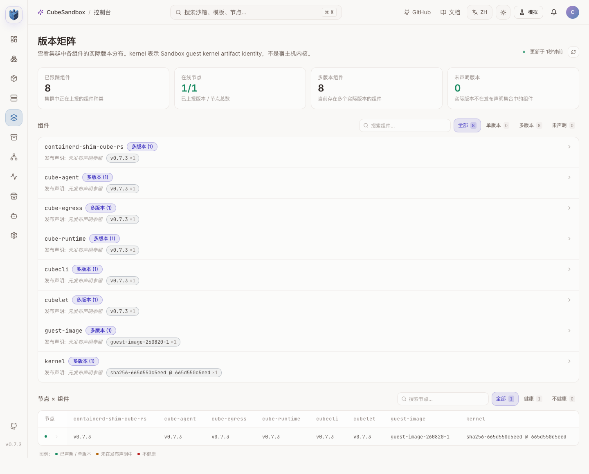
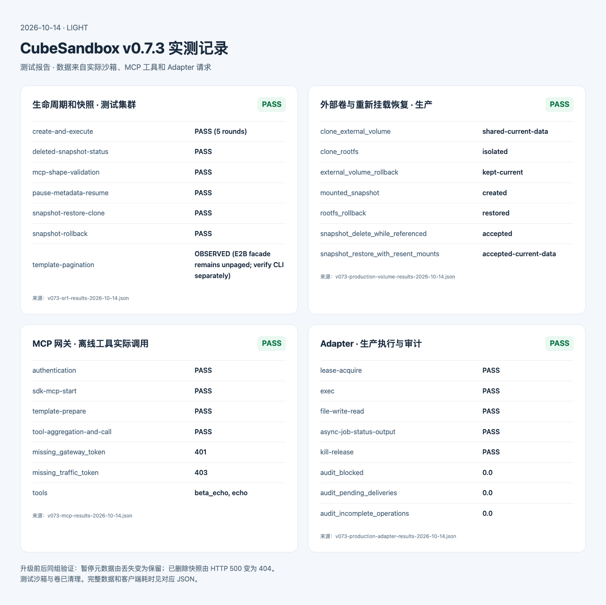
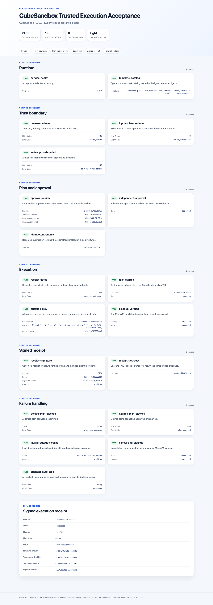

# CubeSandbox upstream status / 上游状态

Checked on 2026-10-14 / 核对日期：2026-10-14.

## v0.7.3：升级和实测（2026-10-14）

[v0.7.3](https://github.com/TencentCloud/CubeSandbox/releases/tag/v0.7.3)
于 2026-10-12 发布。本次测试集群和生产集群均从 v0.7.2 升到 v0.7.3，
Helm revision 分别为 9 和 18。生产三个计算节点均健康、已恢复调度。
MySQL、Redis、MinIO、现有模板和 Adapter 审计数据保留，没有清空重装。

### 新特性和兼容性

- 新增沙箱内 MCP 网关：SDK 创建沙箱时可启动多个 stdio MCP server，
  通过一个 HTTP 入口调用聚合工具。需要包含 `mcp-gateway` 的模板，并暴露
  `50005` 端口；把程序写入普通代码沙箱后做快照，不会自动增加暴露端口。
  [官方 MCP 文档](https://github.com/TencentCloud/CubeSandbox/blob/v0.7.3/docs/guide/mcp-gateway.md)
  说明这是预览功能。同一沙箱中的 server 默认以 root 运行、共享一个信任域，
  不能代替 Adapter 的权限、审批和持久审计。
- 修复暂停后丢失元数据、模板信息和挂载信息；接受快照恢复时重新发送卷挂载。
  已删除快照创建沙箱返回 `404`，不再返回 `500`。
- 网络修复包括端口映射键加入 sandbox IP、网卡复用后的连接问题和连接回收。
  克隆资源选择、shim 存活时的资源回收和模板列表查询也有修复。
- 模板分页适用于 CubeMaster `/cube/template` 和 `cubemastercli`。
  E2B `/templates?limit=1` 仍返回全量列表；不能把两套接口混用。
- [PyPI SDK 0.7.3](https://pypi.org/project/cubesandbox/0.7.3/) 也已在
  2026-10-12 发布。v0.7.3 Git tag 中的 `pyproject.toml` 仍写 `0.7.0`，
  因此记录区分源码 SDK、已发布包和后端版本。线上 Adapter 本次保留原镜像及
  `cubesandbox==0.7.0`，实际租约、执行、文件和异步任务回归通过；新包单独验证。
  生产审计最终核对为：未完成操作 0、待投递记录 0、阻断状态 0。

### 部署过程

19 个组件镜像通过中转机 Registry → Registry 复制，没有在本地拉镜像层。
固定 linux/amd64 manifest，核对源/目标 config 和 layer digest 后，经镜像服务
同步到生产。生产 WebUI 派生镜像保留原有内部模板镜像地址，不恢复外网地址。

升级前保存 Helm 配置，并在 MySQL 持久卷保留逻辑备份。先升级 CubeOps，
再更新控制面；计算节点在 CubeOps 内隔离超过 60 秒，并确认沙箱库存为空。
生产临时使用 OnDelete，逐个更新 bootstrap、installer 和 cube-node，确认就绪
后解除隔离，最终恢复原 RollingUpdate 策略。节点标签、存储类、宿主机内核和
`cubeNode.hostNetwork: false` 均未改动。

生产第一次预检查失败是 Helm `--reuse-values` 把已置空的默认 cube 标签选择器
重新渲染成空字符串；不是 CPU 不足。使用保存的完整配置配合 `--reset-values`
重新渲染后，只保留原有的节点选择条件，预检查通过。
按照[官方升级指南](https://github.com/TencentCloud/CubeSandbox/blob/v0.7.3/docs/guide/kubernetes/upgrade.md)，
Pod 网络模式必须先排空沙箱，不能依靠 Pod 重建保留原沙箱网络。

### 实测结果

| 检查 | 测试集群 | 生产集群 |
| --- | --- | --- |
| 创建、执行、删除 | 5 轮通过 | 3 轮通过 |
| 暂停元数据、恢复文件 | 通过 | 通过 |
| Snapshot、Rollback、Restore、Clone 和根文件隔离 | 通过 | 通过 |
| S3 外部卷当前数据、克隆共享、重新发送挂载恢复 | 7 项通过，7 项清理完成 | 同左 |
| 已删除快照 / 非法 MCP 参数 | 404 / 400 | 404 / 400 |
| CLI 模板分页 | limit=1 返回 1 条 | limit=1、offset=1 返回 1 条 |
| MCP 网关和工具调用 | 新建离线模板通过 | 本轮未部署 MCP 模板 |
| Adapter 可信任务 | 19 项通过 | 租约、执行、文件、异步任务、释放通过 |

测试集群升级前后采用同一组 canary：暂停元数据从丢失变为保留；
已删除快照返回码从 500 变为 404；非法 MCP 参数从被忽略变为 400。
创建 API 的 5 轮中位数为 146.33 ms，删除为 130.53 ms，首条命令为
88.44 ms；均是经过本地端口转发的客户端耗时，测试配置不是官方基准。
MCP 用两个无需外网的 Echo server 验证同名工具聚合为 `echo` 和 `beta_echo`，
两个工具均实际返回预期标记。缺少网关令牌返回 401，缺少代理流量令牌返回 403。
新建 MCP 模板及相关测试沙箱已删除，原有模板未改动。

PVM 宿主机内核更新、S3lvol 热升级和大规模跨节点性能不在本轮运行配置中。
本轮没有重新运行所有 Agent 客户端 TUI，也没有重做 Claude 验证。

源码 SDK 的 288 项非 E2E 测试通过；Adapter 本地 53 项测试中 52 项通过、
1 项可选 Redis 集成跳过，Hermes 2 项、验收解析 3 项、可信执行 5 项及
OpenClaw/DSH 插件、安装脚本、Lint、Helm 检查通过。
已发布 SDK 0.7.3 也通过同一组 288 项 SDK 测试、53 项 Adapter 测试
（同样跳过可选 Redis 集成）及 5 轮真实生命周期/快照回归；没有因此替换线上
Adapter 镜像或发布新的 Adapter 版本。

### 证据和复现

- [升级前基线](assets/cubesandbox-upstream/v072-before-v073-2026-10-14.json)、
  [测试集群结果](assets/cubesandbox-upstream/v073-sr1-results-2026-10-14.json)、
  [生产结果](assets/cubesandbox-upstream/v073-production-results-2026-10-14.json)。
- [测试卷快照结果](assets/cubesandbox-upstream/v073-volume-results-2026-10-14.json)、
  [生产卷快照结果](assets/cubesandbox-upstream/v073-production-volume-results-2026-10-14.json)。
- [MCP 结果](assets/cubesandbox-upstream/v073-mcp-results-2026-10-14.json)、
  [可信任务 19 项验收](assets/cubesandbox-upstream/v073-trusted-acceptance/results.json)、
  [生产 Adapter 结果](assets/cubesandbox-upstream/v073-production-adapter-results-2026-10-14.json)、
  [已发布 SDK 0.7.3 实测](assets/cubesandbox-upstream/v073-published-sdk-results-2026-10-14.json)。

真实控制台版本页，Light 模式，内部标识已遮盖：



快照、MCP 和生产 Adapter 的真实结果报告，Light 模式：



可信任务验收报告，Light 模式；数据来自实际 Adapter 请求：



通用回归脚本为 `tests/acceptance/cubesandbox_release_smoke.py`，使用 SDK 的
`CUBE_API_URL`、`CUBE_PROXY_NODE_IP`、`CUBE_PROXY_PORT_HTTP`、`CUBE_TEMPLATE_ID`
连接变量。卷测试增加 `--backend` 和 `--restore-with-mounts`，保留旧版本默认行为。
MCP 脚本 `tests/acceptance/cubesandbox_mcp_gateway_smoke.py` 要求传入预先构建、
暴露 50005 的离线模板，搭配 `mcp_echo_server.py`；不会在执行时下载 MCP server。

## Historical release channels / 历史发布通道（2026-10-08）

[CubeSandbox v0.7.2](https://github.com/TencentCloud/CubeSandbox/releases/tag/v0.7.2)
is the latest stable release as of 2026-10-08. It was published on 2026-09-24;
there has been no later stable release. It adds:

- faster S3-backed cross-node restore reads through a local object cache and
  coalesced GETs; upstream reports under one second to `running` with its
  default MinIO setup, which is not a measurement of this cluster;
- a JuiceFS persistent-volume plugin and automatic reclaim of idle guest
  memory;
- fixes for incremental snapshot data loss, snapshot/template references,
  template-build races, S3lvol hot-upgrade I/O errors and overlay-CNI guest MTU;
- the Kubernetes `cube-node` host-network default and a faster guest cold-start
  path; upstream also documents an OpenCode Bash redirection hook. This
  Adapter's OpenCode MCP tools retain separate server-side approval and audit.

The upstream `master` branch has additional commits through 2026-10-08, but
they are **not part of the v0.7.2 tag**. Relevant examples are
[#1861](https://github.com/TencentCloud/CubeSandbox/pull/1861) (preserve sandbox
metadata across pause), [#1894](https://github.com/TencentCloud/CubeSandbox/pull/1894)
(accept re-sent volume mounts during snapshot restore) and
[#1810](https://github.com/TencentCloud/CubeSandbox/pull/1810) (avoid reclaiming
sandbox resources while its shim may still be alive). Do not rely on these
changes in a deployed v0.7.1 backend or a stock v0.7.2 image.

[CubeSandbox v0.7.1](https://github.com/TencentCloud/CubeSandbox/releases/tag/v0.7.1)
was released on 2026-09-11 and remains this project's last backend with the
full 30-check Adapter/client acceptance suite. Its key changes were:

- 独立的 CubeTemplateCenter 支持多副本 CubeMaster，生命周期管理支持主备；
- 带 Host Mount 或 Volume Plugin 的 Sandbox 可以执行 Snapshot、Restore、
  Rollback 和 Clone；
- 模板构建产物可以存入 S3/MinIO，并修复并发构建竞争；
- 同 Bucket 跨节点恢复加速，Snapshot 删除和回收语义得到完善；
- 增加 Kubernetes CubeS3lvol、外部 PostgreSQL 和统一的 `redis.db` 配置；
- 修复恢复后日志、非法 CPU/内存、Resume 超时、S3 增量快照、LLM 长响应、
  Registry 凭据日志泄露等问题。

[CubeSandbox v0.7.2-rc1](https://github.com/TencentCloud/CubeSandbox/releases/tag/v0.7.2-rc1)
was reviewed on 2026-09-23. Its changes are now part of the stable v0.7.2
release, including the following upgrade and SDK considerations:

- Kubernetes `cube-node` now defaults to `hostNetwork: true`. Existing releases
  must either pin `cubeNode.hostNetwork: false`, or drain every compute node and
  set the one-time `cubeNode.hostNetworkChangeAck: true` migration acknowledgement.
- Host networking preserves the sandbox TAP devices and cubevs hooks when the
  Big Pod is recreated, but Kubernetes NetworkPolicy no longer governs sandbox
  traffic. Host ports, Service/sandbox CIDR overlap, Cilium/eBPF interaction and
  Pod Security admission must be validated before adopting the new default.
- Snapshot correctness work freezes the VM across memory and rootfs capture and
  preserves rootfs artifacts referenced by snapshots. S3lvol gains hot-upgrade
  I/O pausing, faster restore reads and namespace-ID reuse.
- The Python SDK source now always uses CubeSandbox's direct Connect API for
  commands and adds optional user selection to more filesystem calls, removing
  the optional E2B command implementation path.
- The upstream repository now documents an OpenCode `tool.execute.before` hook
  that redirects the built-in Bash tool. This Adapter's OpenCode integration is
  different: it exposes explicit MCP tools, server-owned policies, approval,
  durable audit and receipts instead of transparently rewriting Bash.

Although `sr1` is absent from the current gmanctl workspace, it remains
reachable through the local `kubectl --context sr1` kubeconfig. On 2026-10-08,
sr1 was upgraded from v0.7.1 to v0.7.2 with `cubeNode.hostNetwork: false`
preserved; the reachable `gd18-ai-002` production deployment remained on
v0.7.1. A future host-network migration requires draining each compute node
and explicitly acknowledging the change. The upstream guide still requires a
compute-node drain even when host networking is already in use, pending live
validation of sandbox survival through a cubelet restart.

On 2026-10-09, `gd18-ai-002` was also upgraded to v0.7.2. On 2026-10-10, the
Adapter was recovered from one audited operation left unresolved after its
five-minute backend sandbox expired before the one-hour lease idle TTL. The
original audit event was retained and reconciled only after CubeAPI confirmed
the sandbox was gone. A candidate Adapter fix passed a live expired-lease,
re-acquire, command and cleanup check on that cluster. This is a targeted
regression check, not the full Adapter/client acceptance suite.

### Backend release and SDK package are different versions

The v0.7.2 Git tag still declares Python package version `0.7.0`, and
[PyPI](https://pypi.org/project/cubesandbox/) still publishes `0.7.0` as the
latest SDK on 2026-10-08. The Adapter therefore keeps
`cubesandbox==0.7.0`: backend and SDK release numbers are separate. The
v0.7.2 SDK changes are only available from source, including direct Connect
RPC command execution and Connect timeout handling. An isolated check using
the stable v0.7.2 SDK source passed all 47 runnable Adapter Python tests (one
optional Redis integration test skipped); the upstream SDK suite passed 269
non-E2E tests. The SDK was also used for the sr1 v0.7.1/v0.7.2 live canaries
below. These are not the full Adapter/client acceptance suite. CubeMaster
continues to proxy the existing template APIs to CubeTemplateCenter, so the
upstream HA split does not require an Adapter API change.

### 2026-10-08 sr1 recovery, upgrade and live canaries

The first v0.7.1 canary was blocked before sandbox creation: CubeMaster returned
`130400`, because CubeOps marked the only node `HeartbeatExpired` even though
the `agent-code` template and its local replica were `READY`. The last persisted
heartbeat was 2026-09-23; node-status upserts were failing. The sr1 test
MySQL 10 GiB PVC was full, with about 9.5 GiB of binary logs and about 15 MiB
of application database files. This was an environment failure, **not** a
reproduction of [#1893](https://github.com/TencentCloud/CubeSandbox/issues/1893).

With approval for test-cluster cleanup, the MySQL PVC was expanded to 12 GiB
after the full disk prevented MySQL from starting. Old binary logs were then
purged with MySQL's `PURGE BINARY LOGS` command, leaving the active log and
about 2% of the PVC used. Retention was persistently shortened from 30 to
7 days. No binlog files were manually deleted. A compressed logical database
backup was validated and retained outside this repository before the upgrade.
Node heartbeat recovered to `Healthy: true`.

All 19 v0.7.2 Cube-owned images were copied through the image relay to the
private test registry, with source/target digest checks; sr1 actually pulled
the `cube-api` image in a temporary probe Pod. Helm release `cube` was upgraded
from revision 6 / v0.7.1 to revision 7 / v0.7.2 using the current user values
on top of new chart defaults. The pre-upgrade dry run and deployed release both
kept `hostNetwork: false`. All CubeSandbox Pods became Ready, the node reported
Healthy, and all eight enabled upstream Helm test groups passed.

Using the v0.7.2 Python SDK source and the existing `agent-code` template,
five serial create/first-command/delete rounds passed both before and after
the backend upgrade. The fifth round in each set also passed pause, resume and
a command after resume. Mean create times were 190 ms on v0.7.1 and 137 ms on
v0.7.2, but five samples are a functional canary, **not** a performance claim.
On v0.7.2, a separate canary passed snapshot creation/listing, rootfs rollback,
creation from that snapshot, and snapshot deletion. The sandbox and snapshot
counts returned to their pre-test baselines. The redacted results are in
[`v072-results-2026-10-08.json`](assets/cubesandbox-upstream/v072-results-2026-10-08.json).

These results do not prove the open issues are closed. The reused `agent-code`
template predates v0.7.2; sr1 TemplateCenter cannot anonymously pull its
private base image to build a fresh v0.7.2 template, and the affected artifact
from #1893 was not available. No guest-agent failure, failed-resume storage
fault, or shim-log rotation was injected for #1890, #1847, or #1896.

On 2026-09-12, the Kubernetes acceptance environment was upgraded from v0.7.0
to v0.7.1 while the Adapter kept the published `cubesandbox==0.7.0` SDK. All
CubeSandbox workloads became Ready, all eight upstream Helm test groups passed,
and the Adapter/backend suite passed 30/30 checks. The publication captures and
the mounted-volume result are recorded in the
[trusted-execution guide](trusted-execution.md#live-acceptance-evidence).

The same mounted-volume scenario was rerun on 2026-09-23 without upgrading the
backend. It again passed snapshot creation, rootfs rollback, external-volume
current-state semantics, clone/remount, referenced-snapshot deletion and all
six cleanup checks. Before and after the run the cluster had zero active
sandboxes, zero volumes and the same two pre-existing snapshots. The redacted
machine-readable result is
[`snapshot-results-2026-09-23.json`](assets/cubesandbox-upstream/snapshot-results-2026-09-23.json).

### Mounted-workspace checkpoint semantics

v0.7.1 closes [#1599](https://github.com/TencentCloud/CubeSandbox/issues/1599),
but a mounted-workspace checkpoint is an **external-reference checkpoint**:

- VM memory and rootfs are restored to the checkpoint state;
- files below a Host Mount or Volume Plugin mount are not copied into the
  checkpoint and remain at their latest external state;
- upstream preserves origin-node affinity for snapshots with Host Mounts and
  external volumes; clones can deliberately share writable mounted data;
- point-in-time data consistency still needs a storage-provider snapshot or an
  application freeze coordinated outside this Adapter.

The Adapter therefore keeps `allow_checkpoint_with_mounts: false` as the safe
default. On a v0.7.1-or-newer backend, an operator may enable it only after
validating node affinity, volume remounting, read-only behavior and the desired
data-consistency model:

```yaml
profiles:
  durable-checkpoint-code:
    checkpoints_enabled: true
    allow_checkpoint_with_mounts: true
    workspace:
      mode: per-session-volume
      retain_on_kill: true
```

The Adapter does not currently perform a backend version handshake. Enabling
the gate against an older backend will pass the request upstream and fail there.

### Upgrade notes that matter to operators

- For v0.7.1 to v0.7.2 on the current Pod-network deployment, explicitly set
  `cubeNode.hostNetwork: false` in Helm values. Changing it to `true` requires
  per-node isolation, at least 60 seconds of drain, destruction of resident
  sandboxes and the one-time `cubeNode.hostNetworkChangeAck: true`. The flag
  acknowledges the migration; it does not perform the drain. Check host-port,
  Cilium/eBPF and policy behavior before choosing host networking.
- Canary the control and compute-plane images in the order in the upstream
  v0.7.2 guide. Rebuild at least one template with the new components, then
  repeatedly test create, first command, pause/resume, snapshot, clone and
  cleanup before moving an alias. Check Cubelet/shim process counts and node
  resources after failed creates, not just API success rates.
- The v0.7.2 release's sub-second cross-node restore claim is tied to its
  default MinIO and S3 cache configuration; benchmark our own storage and
  network path before using it as a capacity or latency target.
- CubeS3lvol is now opt-in. Existing nodes that used S3 implicitly must set
  `[cow.s3] enable = true`, or `ONE_CLICK_ENABLE_S3LVOL=1` for one-click
  deployments, before relying on cross-node S3 restore.
- CubeTemplateCenter becomes the template build path and needs durable
  S3/MinIO artifact storage. Existing CubeMaster template endpoints are proxied
  for client compatibility.
- A Kubernetes compute-plane image or Pod-template upgrade can recreate the
  `cube-node` DaemonSet Pod and interrupt existing sandboxes. Isolate and drain
  nodes according to the upstream upgrade guide; do not treat v0.7.1 control-
  plane HA as compute-plane live migration.
- The new top-level Helm `redis.db` should be set explicitly when several
  CubeSandbox clusters share one Redis instance.

### Findings from the live v0.7.0 to v0.7.1 upgrade

- The first Helm upgrade hit an immutable Redis StatefulSet
  `volumeClaimTemplates` change when v0.7.1 introduced stable labels. The test
  environment recorded the Redis Pod/PVC identities, orphan-deleted only the
  StatefulSet, reran the forward upgrade, and verified that the same Pod and PVC
  were adopted. Back up Redis first and repeat those identity checks before and
  after the change; do not delete the PVC.
- Database migrations had already advanced when the first upgrade failed. The
  v0.7.0 CubeMaster could not start against that newer schema, so automatic
  binary rollback was not a usable recovery path. Take a database backup and
  prepare a forward-fix procedure before upgrading.
- Templates retain their agent and shim component versions. A template built on
  v0.7.0 could still start a sandbox, but v0.7.1 rejected a snapshot clone whose
  metadata named the older agent. Rebuild the template after the control and
  compute planes are upgraded, verify its component annotations, then move the
  stable alias. Keep the old template unaliased until rollback decisions are
  complete.
- Private-image template builds require registry credentials. Supply them at
  execution time and keep them out of values files, command transcripts and
  screenshots.
- Treat CubeMaster and CubeTemplateCenter startup output as sensitive. This run
  observed effective configuration values in startup logs, so raw logs were not
  retained or published. Restrict log access and retention, inspect masking in
  the exact release, and rotate any credential whose value has entered an
  exported log.

## Issues to follow / 建议持续跟进的 Issue

State was re-checked through the GitHub API on 2026-10-08. The newly added open
reports below used older backend versions, so their presence on v0.7.2 is not
established by the issue reports alone.

| Issue | State / 状态 | Why it matters here / 对本项目的影响 | Current handling / 当前处理 |
| --- | --- | --- | --- |
| [#1395 Declarative runtime profiles](https://github.com/TencentCloud/CubeSandbox/issues/1395) | Open; last updated 2026-08-27. | Upstream-native policy profiles could reduce duplicated policy mapping. | Adapter profiles remain operator-owned YAML and translate into SDK arguments. |
| [#1599 Snapshots with volumes/host mounts](https://github.com/TencentCloud/CubeSandbox/issues/1599) | Closed 2026-09-08; delivered by [#1654](https://github.com/TencentCloud/CubeSandbox/pull/1654) and [#1656](https://github.com/TencentCloud/CubeSandbox/pull/1656). | Mounted checkpoint operations now work, but external data stays current rather than rolling back. | Keep the explicit opt-in gate and validate the external-reference semantics on v0.7.1 before enabling it. |
| [#1598 Restored stdout/stderr logs](https://github.com/TencentCloud/CubeSandbox/issues/1598) | Closed 2026-09-02; the fix is listed in v0.7.1. | Restored sandbox log output is repaired upstream. | Adapter durable jobs still persist their own stdout/stderr/exit files for independent recovery. |
| [#1414 CubeAPI default unauthenticated](https://github.com/TencentCloud/CubeSandbox/issues/1414) | Closed 2026-09-03. | Control-plane authentication remains a deployment boundary even after the upstream issue closes. | Keep `CUBE_API_KEY`, private reachability, TLS/mTLS or OIDC and restrictive NetworkPolicy. |
| [#1484 Non-positive SDK command timeout](https://github.com/TencentCloud/CubeSandbox/issues/1484) | Closed 2026-08-28; v0.7.1 contains Node/Python source fixes. | The fix has not been published as a Python 0.7.1 package. | Adapter request and profile validation already require positive command timeouts, so this path is not used. |
| [#1521 Pause/resume stuck edge](https://github.com/TencentCloud/CubeSandbox/issues/1521) | Closed 2026-09-02. | Older deployments could leave leases stuck after failed lifecycle operations. | `/readyz`, status refresh, last-error state and GC visibility remain in place. |
| [#1565 Concurrent scheduling overcommit](https://github.com/TencentCloud/CubeSandbox/issues/1565) | Closed 2026-09-17 after design discussion; the linked consolidation PR [#1595](https://github.com/TencentCloud/CubeSandbox/pull/1595) was closed without merge. | Closing the report is not evidence that concurrent admission or compounded overcommit was changed in a release. | Keep tenant lease/job quotas and node-capacity alerts; load-test the exact scheduler configuration before raising concurrency. |
| [#1893 READY template may not restore](https://github.com/TencentCloud/CubeSandbox/issues/1893) | Open; reported on v0.5.1. A maintainer [said on 2026-10-08](https://github.com/TencentCloud/CubeSandbox/issues/1893#issuecomment-6051145081) that a wrong-guest-memory snapshot bug was fixed in v0.7.2 and asked the reporter to retry. | A template can report `READY` while repeated sandbox creates fail during guest-time reset; whether the reported case is fixed still needs a reporter or independent retest. | After each template rebuild, test several create-and-command cycles before moving its alias; record failures by template ID. The sr1 run was blocked by a separate MySQL/heartbeat failure before any restore. |
| [#1890 Failed-create shim leak](https://github.com/TencentCloud/CubeSandbox/issues/1890) | Open; reported on v0.5.1, updated 2026-10-08. | Repeated failed creates reportedly left orphan shims and exhausted node memory. | Monitor failed creates, shim count and memory together during canary; do not infer a v0.7.2 fix from its release notes. |
| [#1847 Failed resume leaves rootfs CoW object](https://github.com/TencentCloud/CubeSandbox/issues/1847) | Open; reported on v0.7.0, updated 2026-10-08. | A mid-resume failure can reportedly make a paused sandbox impossible to resume. | Include forced-failure resume and recovery in storage-specific acceptance before relying on long-lived paused sandboxes. |
| [#1896 Rotated shim logs absent from API](https://github.com/TencentCloud/CubeSandbox/issues/1896) | Open; filed 2026-10-08 for a newer one-click logrotate change. | Sandbox log queries may cover only the current log segment after rotation. | Continue treating Adapter-owned durable job output and audit records as the retention source; verify API log history if enabling the new rotation policy. |

## Integration guide follow-up / 集成指南跟进

[#244](https://github.com/TencentCloud/CubeSandbox/issues/244) remains open. The
Hermes Agent and DeepSeek Harness guide slots were claimed on 2026-08-29, and
bilingual guide drafts have been prepared against the upstream template. They
currently cite the v0.2.0 evidence. The v0.4.0 release adds refreshed real
CubeSandbox acceptance evidence for trusted tasks across OpenClaw, DSH, Codex,
and Hermes; update the upstream drafts to cite it before opening an external
pull request. No external pull request is created from this working tree
automatically.

The v0.5.0 follow-up additionally validates Claude Code through both the
trusted-task MCP flow and the Codex-equivalent acquire/exec/status/release
flow. Its light native-client captures can be cited from the main README.

## Feature decisions / 功能决策

- Persistent Volume and Checkpoint are separate profile capabilities; neither
  silently implies the other.
- Redis durability protects Adapter ownership data, not CubeSandbox's internal
  scheduler state.
- Kubernetes HA improves the Adapter and control-plane operations, but cannot
  hide compute-node pause/resume, snapshot or overcommit defects.
- `CUBE_API_KEY`, TLS/mTLS or OIDC, strict egress, and centralized audit should
  be treated as a deployment set rather than independent checkboxes.

Re-check the open issues before raising tenant quotas substantially. Before
enabling `allow_checkpoint_with_mounts`, run restore, rollback, clone, read-only
mount and cleanup tests on the exact storage driver and node topology. Before a
production upgrade, also follow the upstream
[Kubernetes upgrade guide](https://github.com/TencentCloud/CubeSandbox/blob/v0.7.2/docs/guide/kubernetes/upgrade.md)
and the [v0.7.2 release notes](https://github.com/TencentCloud/CubeSandbox/releases/tag/v0.7.2).
