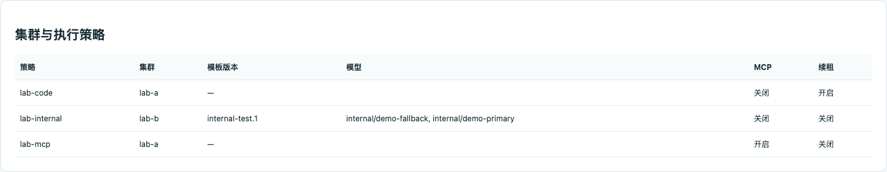
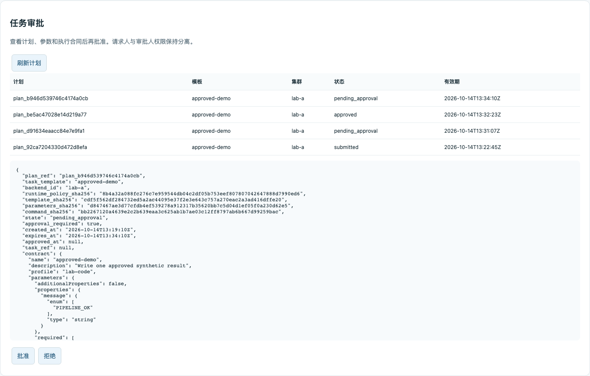
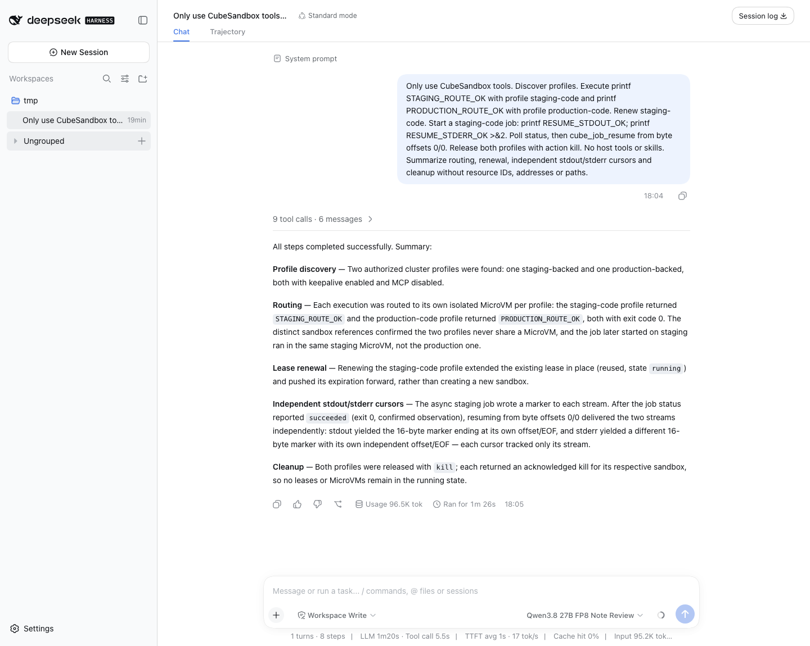
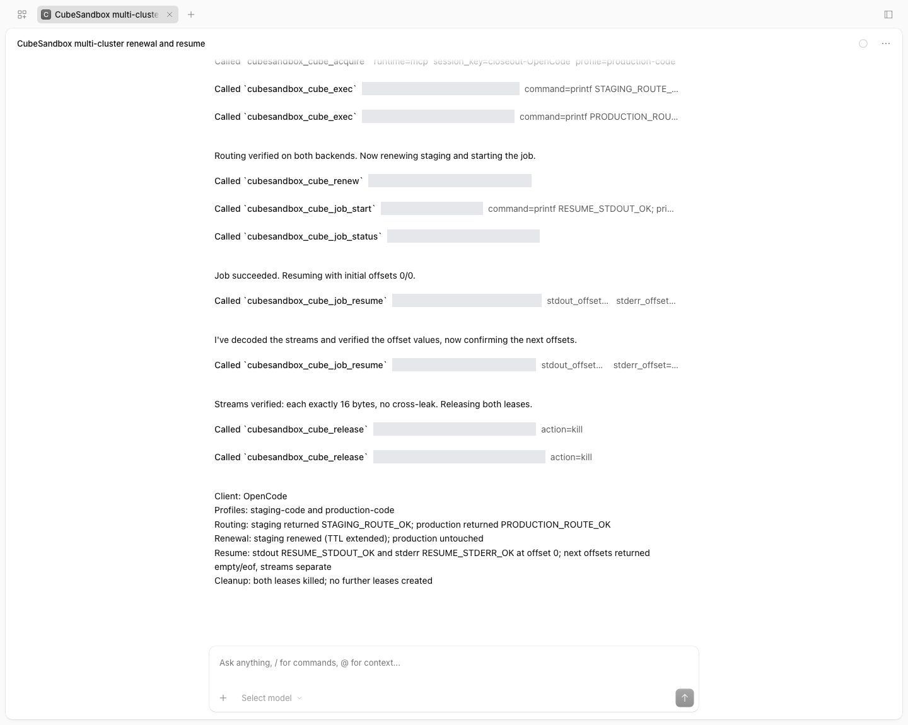

# Multi-backend execution and durable audit

These capabilities ship in Adapter v0.6.0, tested with CubeSandbox v0.7.3.
Use `ghcr.io/aik8s/cubesandbox-agent-adapter:v0.6.0`; older v0.5.0 images
do not implement them. Verify the release image and pin its digest before deploying.
The detailed [Chinese guide](production-features.zh-CN.md) covers configuration,
network boundaries, rollout and migration; executable examples are in
[production-features](../examples/production-features/).

## Capabilities

- Operator-owned backend registry: a Profile binds CubeAPI, CubeProxy and
  credentials by `backend_id`. Live leases retain an endpoint fingerprint;
  rebinding is rejected, not silently routed into another cluster.
- Versioned internal template presets: late-bound Secret injection, fixed
  bootstrap/preflight commands, OpenClaw primary/fallback model registry
  validation and restrictive file permissions. The operator must prevent an
  official initializer from overwriting the injected configuration.
- Governed sandbox MCP: registered server commands, tool allowlists, closed
  input schemas, bounded transport subprocess, credential redaction and audit.
  MCP profiles require private traffic and currently cannot use checkpoints.
- Policy-bounded lease renewal and restart inventory using encrypted Redis
  state. Independent Base64 stdout/stderr byte cursors resume logs without
  re-running jobs. Recovery does not recreate expired or uncertain executions.
- Light `/console`: independent task approval, filtered durable audit history,
  pagination, execution-chain details and current-page JSONL export. Tokens
  remain in page memory; remote access requires HTTPS. Auditors and approvers
  see only their own tenant; admins may see all tenants.
- PostgreSQL required-audit authority: synchronous intent/result/outbox
  transactions, fenced expiring writer ownership, shared blocking on uncertain
  outcomes, leased delivery claims and event hash chains. SQLite remains the
  default single-writer local/block-storage backend.

All native plugins expose `cube_profiles`, `cube_mcp_list`, `cube_mcp_call`,
`cube_renew`, `cube_recover` and `cube_job_resume`. Lease-based native tools
accept an optional server-authorized `profile`; MCP hosts select it in
`cube_acquire`. No Agent receives an approval tool or arbitrary backend URL.

## Operator configuration

| Setting | Purpose |
| --- | --- |
| `CUBE_ADAPTER_BACKENDS_FILE` | Backend registry YAML |
| `CUBE_ADAPTER_TEMPLATE_PRESETS_FILE` | Versioned internal template catalog |
| `CUBE_ADAPTER_MCP_POLICIES_FILE` | Registered sandbox MCP policy catalog |
| `CUBE_ADAPTER_AUDIT_DATABASE_URL` | Secret-delivered PostgreSQL DSN |
| `CUBE_ADAPTER_AUDIT_DATABASE_SCHEMA` | Dedicated authority namespace |
| `CUBE_ADAPTER_AUDIT_REQUIRE_SYNC_REPLICA=1` | Reject missing synchronous-standby configuration |
| `CUBE_ADAPTER_REPLICAS` | Validate multi-replica state/audit requirements |
| `CUBE_ADAPTER_KEEPALIVE_INTERVAL` | Renewal cadence; less than half the initial sandbox timeout |

Use `${FILE:/absolute/secret/path}` or `${ENV:NAME}` leaves for credentials.
Do not embed keys into images or ConfigMaps. Shared replicas need the same
encrypted, durable Redis state, key material, profiles and backend bindings.
Agent task plans bind the runtime policy: changing it invalidates approval.
Pre-upgrade plans lacking this binding must be recreated.

Backend registration does not create network routes. The Adapter still needs
both CubeAPI and CubeProxy. SDK 0.7.3 uses HTTP for its data plane; office-to-
production paths need a controlled private link/tunnel, not an API-only HTTPS
Ingress. Existing network labels, NAT and storage are not changed by this work.

## Database and operational boundaries

PostgreSQL writer failover is not database HA. Configure reliable storage,
synchronous standbys, TLS (`sslmode=verify-full`), backups, WAL archiving and
restoration drills separately. A nonempty synchronous-standby setting is a
configuration guard, not proof of a healthy failover system. See the
[PostgreSQL WAL documentation](https://www.postgresql.org/docs/current/runtime-config-wal.html).

Loss of an audit writer is detected at ownership expiry (60 seconds by default).
Unknown external operations block execution and require operator review; they
are never retried automatically. An expired writer cannot rejoin. External
MicroVM actions and database commits are not one distributed transaction.

Sink delivery remains at-least-once: deduplicate by `event_id`. PostgreSQL is
the authority; JSONL/stdout are replicas. Hashes require an independently kept
trusted anchor and do not prevent a database administrator rewriting history.
No automatic audit pruning or production data migration is enabled.

Stop all writers before offline inspection/reconciliation or SQLite migration:

```sh
python -m adapter.audit_admin --database /durable/audit.jsonl.sqlite3 pending
python -m adapter.audit_admin --database /durable/audit.jsonl.sqlite3 verify
python -m adapter.audit_admin --database /durable/audit.jsonl.sqlite3 export --output /secure/archive.jsonl
python -m adapter.audit_admin --postgres-url-env AUDIT_DSN import-sqlite --source /durable/audit.jsonl.sqlite3
python -m adapter.audit_admin --postgres-url-env AUDIT_DSN verify
```

The import requires an empty target and a reconciled, stopped source. It retains
event IDs, original chain anchors and pending deliveries without modifying
source records or replaying acknowledged history. Archives are exclusive 0600
files with SHA256 manifests. Back up Redis execution state independently.

## Validation and Light UI evidence

These are real candidate-Adapter pages using a test tenant and synthetic tasks:






- [Console acceptance](assets/production-features/console-results-2026-10-14.json): approval, query and export passed; no token in browser storage.
- [sr1 execution](assets/production-features/live-results-2026-10-14.json): two Adapter processes sharing PostgreSQL/Redis validated backend binding, configuration injection, governed sandbox MCP, job restart/resume, approval and signed receipts. Test sandboxes/templates were cleaned.
- [Two real control planes](assets/production-features/multi-cluster-readonly-2026-10-14.json): read-only readiness, template lookup and proxy connectivity. The sr1 execution suite uses two logical bindings, not two independent writable clusters.
- [PostgreSQL outage and restore](assets/production-features/postgres-fault-restore-2026-10-15.json): both instances returned 503 with zero instrumented backend calls during the outage; old instances remained fenced. Restart restored execution. A separate database restored all 15 events and the same chain tip without overwriting the source. This drill isolates the audit boundary with an instrumented factory; real sandbox execution is covered separately on sr1.
- [Stronger renewal acceptance](assets/production-features/live-results-2026-10-15.json): a 35-second job survived an Adapter restart with a 15-second initial timeout, kill-on-timeout and auto-resume disabled. Six renewals were recorded; the command was not relaunched. Sandboxes and the temporary template were cleaned.
- [Final regression](assets/production-features/regression-2026-10-15.json): all 75 Adapter tests passed with no skips, including five PostgreSQL and one Redis integration test, plus native plugins, installers, Helm, Ruff and Mypy.

### Two real clusters and native clients — October 15, 2026

- [Two-cluster write acceptance](assets/production-features/multi-cluster-live-2026-10-15.json): one isolated Adapter created and executed sandboxes on sr1 and gd18-ai-002, verified actual resource ownership, same-session Profile isolation, unauthorized-Profile denial and backend-filtered audit. All temporary sandboxes were deleted; the existing production Adapter configuration was unchanged.
- [Native tool-result verification](assets/production-features/clients-live-2026-10-15.json): OpenClaw, DSH, Hermes, Codex and OpenCode completed 50 Cube tool calls. Checks cover discovery, both clusters, targeted renewal, async jobs, independent stdout/stderr byte cursors and release. Verification reads recorded tool results, not the assistant's final claims.
- [Internal-model reply](assets/production-features/openclaw-model-live-2026-10-15.json): a disposable OpenClaw sandbox on the production cluster applied its preset and called the internal Qwen model through `openclaw agent --local`, returning the expected marker. Secrets stayed private; only sandbox-scoped egress to the model Pod was allowed. This verifies embedded CLI execution, not gateway/TUI or every fallback. The sandbox was deleted.

These are native Web UI captures in Light mode. DSH shows an additional Web
repeat of the same flow; the other three show their recorded native sessions.
Full resource references are masked in OpenCode and Hermes.







Codex CLI 0.160.0 passed the real stdio MCP flow. Its native TUI capture is
pending terminal computer-control permission. Claude Code was not rerun in
this round; historical evidence retains its original date.

### Reproduction and upgrade

The operator-only runners create and delete temporary sandboxes; obtain test
authorization for both clusters first. Keep configuration, credentials and raw
client logs outside the repository in a private directory:

```sh
python tests/acceptance/multi_backend_live.py --help
python tests/acceptance/openclaw_preset_live.py --help
python tests/acceptance/verify_feature_clients.py --help
```

Run [the bounded client prompt](../tests/acceptance/feature-client-prompt.txt)
in each native client, then verify its recorded tool results. Headless Codex
acceptance used per-tool `approval_mode="approve"` only for eight tools on the
trusted temporary MCP server, with a read-only host sandbox. Do not globally
bypass approvals. A zero process exit with denied MCP calls is not a pass.

When upgrading v0.5.0, retain audit storage, tokens, HMAC keys and Profiles;
stop writers and reconcile first, then pin the new image digest. Existing tool
names remain valid; native plugins now expose 25 tools. Rerun the OpenClaw
installer to merge the six new allowed tools without removing existing entries.
New routing, presets, sandbox MCP, keepalive and console remain opt-in. SQLite
still permits one writer; multiple replicas require PostgreSQL and encrypted
Redis, not just a replica-count change. Follow the offline migration procedure
before changing audit authority.

## Authorized production candidate upgrade

On 2026-10-15 the candidate was built on the image relay, pushed to staging,
replicated to production and pull-tested in a one-off unprivileged Pod without
business Secrets or the audit volume. The existing Adapter was then updated
to the fixed image digest before the formal release. That source candidate
deployment is not an upgrade to the v0.6.0 release image.

[Production acceptance](assets/production-features/production-upgrade-2026-10-15.json)
passed create/execute/status/audit/delete. All 145,736 historical rows in the
pre-upgrade consistent snapshot retained their original digest; no incomplete
operation remained. Deployment comparison confirmed an image-only change.
The single replica, SQLite audit PVC, Profiles, Secrets and ingress were kept.
New events start the hash chain; legacy history was not rewritten.

The console, MCP policies, automatic renewal and PostgreSQL remain disabled in
production pending separate configuration. Backend components, node labels and
network settings were not changed. The previous Deployment revision 6 and a
consistent snapshot on the existing audit PVC remain available for rollback.
