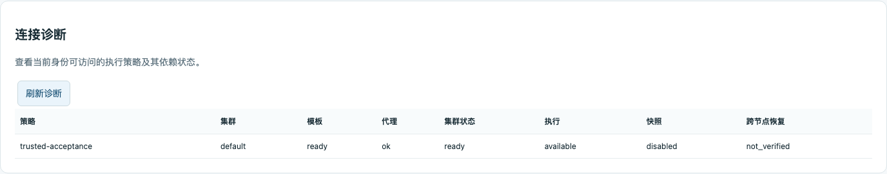
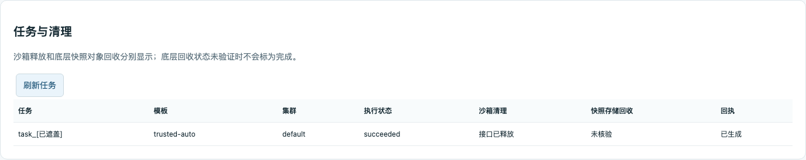

# 远程 MCP、连接诊断与清理状态：功能和实测

本文描述 v0.7.0 的功能，v0.6.0 镜像不包含这些能力。验收使用独立的本地 Adapter 候选进程和测试集群沙箱，没有替换已有服务；实际部署配置及各 Agent 应用的界面联调需要在目标环境另行完成。

## 接入方式

远程 Agent 可以通过 MCP Streamable HTTP 连接 Adapter。每次请求携带调用者自己的 Adapter Bearer Token，MCP 入口先向 Adapter 验证身份，再以该身份执行工具；它不持有用于代替所有用户的共享管理员 Token。沙箱租约、Profile 和工具动作仍按 Adapter 原有的身份与策略约束。

本机调试时，在已有 Adapter 进程旁启动：

```bash
python -m adapter.remote_mcp --adapter-url http://127.0.0.1:18080 \
  --host 127.0.0.1 --port 8788
```

本机 MCP 地址是 `http://127.0.0.1:8788/mcp`。远程监听必须同时配置服务端证书、私钥和允许的 Host，例如 `--host 0.0.0.0 --tls-cert-file /path/tls.crt --tls-key-file /path/tls.key --allowed-host mcp.example.com:8788`。客户端应验证证书；按实际 Host 头填写允许列表。`--allowed-origin` 只在确有浏览器跨域需求时配置。后端为 HTTPS 时可通过 `--adapter-ca-file` 配置受信任 CA；非本机 HTTP 后端会被拒绝。

入口校验已有 Token，不提供 MCP OAuth 授权服务器发现或浏览器登录流程；Token 的颁发与分发仍由部署方负责。请使用独立身份及最小权限，避免把 Token 放进版本库。

Helm 的 `remoteMcp.enabled` 默认关闭。启用时需要使用 v0.7.0 或其他包含本功能的镜像，并设置 `remoteMcp.tlsSecret` 和 `remoteMcp.allowedHosts`。Secret 需包含 `tls.crt` 和 `tls.key`，入口代理也须正确配置到侧车的 TLS；按实际客户端调整现有 NetworkPolicy。侧车与同 Pod Adapter 使用本地 HTTP，Chart 会拒绝同时开启 Adapter 的 `tls.enabled`；若后端需要 HTTPS，可独立运行 MCP 入口并指向 HTTPS Adapter。该入口目前不提供连接后端的 mTLS 客户端证书。

## 诊断与能力发现

使用已有 Adapter 地址，以及 `CUBE_ADAPTER_TOKEN_FILE` 指向只读 Token 文件后运行：

```bash
python -m adapter.doctor
```

也可以通过 MCP、OpenClaw、DSH 或 Hermes 调用 `cube_doctor`。诊断只返回当前身份可访问的 Profile，包括模板状态、代理 TCP 连通状态、后端就绪状态及能力；不会创建沙箱。`available` 表示动作权限和相关功能配置允许该操作，不代表已实际执行成功；调用方还需要确认 Profile 返回的 `allowed_runtimes` 包含自己的客户端类型。`not_allowed` 表示身份缺少对应权限，`disabled` 表示配置未启用；跨节点恢复和持久化产物标记为 `not_verified`，需专项验收。审计系统不可用时，请求可能在认证阶段被拒绝，命令行会返回错误状态。

## 执行结果与清理状态

任务结果及 Light 控制台分别展示执行状态、沙箱释放状态和快照底层存储清理状态。`verified` 代表后端释放接口确认成功；这不等于对象存储中的数据已经完成物理回收。当前 `snapshot_storage_cleanup_status` 固定为 `not_verified`，不会把接口成功推断为 S3 垃圾回收成功。任务清单读取持久化记录，任务进度需要调用任务状态或结果接口更新；清单不会返回任务输出内容。

下面是实际运行后的控制台截图，已遮盖完整任务标识：





## 实测记录（2026-10-27）

使用 MCP Python SDK 连接本地 HTTPS 候选入口，校验证书，并连接测试集群的真实 CubeSandbox：

| 项目 | 结果 |
| --- | --- |
| MCP 2026-07-28、2025-11-25 | 均完成初始化、工具发现、Profile 和诊断调用 |
| 创建、执行和释放 | 创建真实沙箱，执行标记命令并通过接口释放 |
| 可信任务 | 计划、提交、查询、结果和 Receipt 跑通；执行成功，沙箱接口释放已确认，底层存储回收未核验 |
| 租户隔离 | 自动化测试覆盖并发调用身份隔离及跨租户访问拒绝 |
| Redis / PostgreSQL | 独立临时实例的 7 项集成测试通过 |

截图来自真实 Adapter 控制台，协议客户端是 MCP Python SDK。另以独立配置重测了 DSH Web、OpenClaw 本地 Agent、Hermes CLI、Codex CLI 和 OpenCode CLI：调用 `cube_doctor` 和 `cube_profiles`，在真实沙箱执行标记命令并释放；根据客户端原始工具结果核对，而不是只看模型总结。Codex 首次创建调用失败，随后重试成功。原生客户端的新一轮截图尚未完整保存。
测试后的沙箱清单为空；[脱敏结果](remote-mcp-acceptance/results.json)记录了测试范围和未核验项。

## 标准兼容情况

**MCP Tasks 扩展尚未支持。** 当前工具使用 Adapter 的 `cube_task_plan`、`cube_task_submit`、`cube_task_status` 等接口，不把它们冒充标准扩展。实测中服务端没有声明 Tasks 扩展；当前使用的 [MCP Python SDK 迁移说明](https://github.com/modelcontextprotocol/python-sdk/blob/main/docs/migration.md)也注明扩展尚未实现。后续需要按 [MCP Tasks 扩展规范](https://tasks.extensions.modelcontextprotocol.io/)完成能力协商、生命周期与取消语义，再做不同客户端互通验证。

**OpenSandbox 目前不能直接对接。** 使用官方 Python SDK 1.1.1 探测：默认 API Key 请求 Adapter 返回 401；附加 Adapter Bearer 后，请求 `/v1/sandboxes` 返回 404。这次探测没有创建沙箱，也没有实现协议转换。若后续增加兼容层，应明确映射镜像与 Profile、身份权限、命令与文件、超时、删除及错误语义，并用官方 SDK 做完整创建—执行—释放测试，不能把简单路径改写视作完整兼容。
