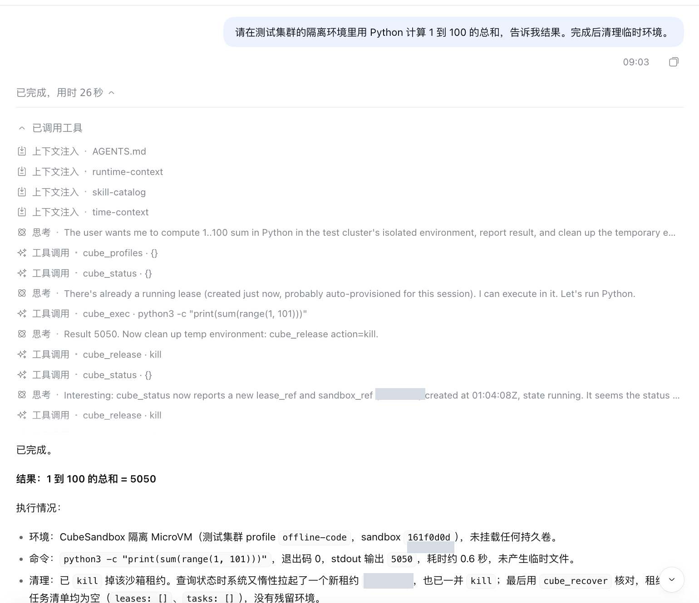

# CubeSandbox tools for DeepSeek Harness

This DSH plugin connects an agent to [CubeSandbox Agent Adapter](https://github.com/aik8s/cubesandbox-agent-adapter), which manages isolated CubeSandbox execution environments. It provides `cube_*` tools for commands, files, asynchronous jobs, checkpoints, and approved tasks. The Adapter enforces its configured profiles and policies.



The screenshot shows a DSH Web session executing a Python calculation in a CubeSandbox environment and cleaning up its leases.

## Requirements

- DeepSeek Harness with plugin-bundle support.
- A running CubeSandbox Agent Adapter connected to CubeSandbox, an Adapter access token, and an authorized profile. See the [deployment guide](https://github.com/aik8s/cubesandbox-agent-adapter#quick-start-kubernetes-adapter).
- Network access from the DSH process to the Adapter. Installing this plugin does not deploy the Adapter or CubeSandbox.

## Install

Install the release package into the DSH profile you use, for example `web`:

```sh
dsh plugin --profile web add https://github.com/aik8s/cubesandbox-agent-adapter/releases/download/dsh-plugin-v0.7.0/cubesandbox-agent-adapter-dsh-plugin-0.7.0.tgz
```

Set the Adapter URL and token in the environment that starts DSH. Supply the token securely; do not paste it into prompts or commit it to a repository.

```sh
export CUBE_ADAPTER_URL='https://adapter.example.com'
read -rs 'CUBE_ADAPTER_TOKEN?Adapter token: ' && export CUBE_ADAPTER_TOKEN
dsh web
```

The token input example uses zsh; use your shell's equivalent if needed. In containers, inject the token as a secret into the DSH process rather than setting it in a Dockerfile or image. The default Adapter URL is `http://127.0.0.1:18080` and the default profile is `offline-code`. The Adapter must authorize that profile for the token.

Alternatively, configure `adapterUrl`, `tokenFile`, and `profile` in a DSH patch overlay. The [integration guide](https://github.com/aik8s/cubesandbox-agent-adapter#quick-start-dsh) covers deployment and the repository installer.

## Try it

In DSH, ask: “In the test cluster's isolated environment, use Python to calculate the sum from 1 to 100, then clean up the environment.” Check the tool calls and the returned result. Availability depends on model tool use, Adapter policy, and the selected CubeSandbox profile.

The bundle adds CubeSandbox tools; it does **not** disable DSH's existing host tools. For an explicitly sandbox-only configuration, use the repository's DSH installer and its generated patch, then review which host tools are disabled. Follow your organization's access, network, and audit policies.

For long commands use `cube_job_start` and inspect or cancel the job rather than waiting synchronously. `cube_status` can acquire a lease; after cleanup use `cube_recover` to inspect remaining leases without creating another one.
